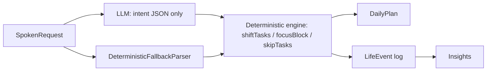

# Life OS: Phase 0 analysis of plan.md

Status: **draft for your review.** Nothing in the app, the seed routine or the database has changed. Every change below is a recommendation that waits for your approval, item by item (section 5).

Scope note: this is a scheduling and habit app, not a coach or a clinic. Where something touches health (supplements, derma stamping, pain, diet), this document flags it and marks it **confirm with a professional**. It does not give medical advice, and the app will not prescribe calories, macros or treatment.

Sources compared:

- `plan.md`: the "Master 7-day athletic protocol" (the new source of truth).
- The app as it runs today: `apps/api/src/seed/rajRoutine.js` (seeded routine), `models.js` (schema), `routes.js`, `voiceAssistant.js`, `shiftTasks.js`, `focusBlock.js`, `insights.js`, and the mobile alarm and reminder code.

---

## 1. Training plan: beginner-safety review

### 1.1 The week at a glance

| Day | Session | Length | Notes |
|---|---|---|---|
| Mon (WFH) | Push: bench, incline DB press, seated DB shoulder press, lateral raise, triceps pushdown, plank | 07:00-08:15 (75 min) | Warm-up listed |
| Tue (WFH) | Pull: lat pulldown, seated cable row, 1-arm DB row, face pull, DB curl, hammer curl, 10 min treadmill | 07:00-08:15 (75 min) | Warm-up listed |
| Wed (office) | Legs: squat (barbell/goblet), DB Romanian deadlift, leg press, seated calf raise | 07:00-07:50 (50 min) | Warm-up listed |
| Thu (office) | Upper circuit: DB clean & press, push-ups, incline DB row, lateral raise, bench dips | 07:00-07:50 (50 min) | Warm-up listed |
| Fri (office) | Core & conditioning: 3 rounds of air squats, mountain climbers, bicycle crunch, push-ups, then 15 min run/walk intervals | 07:00-07:50 (50 min) | **No warm-up listed** |
| Sat | Full body: trap bar/barbell deadlift, DB walking lunge, standing barbell overhead press, pull-ups "to near failure", **plus evening Cult.fit class** (HRX / S&C / dance) | 07:30-08:30 + evening | **No warm-up listed. Two sessions in one day.** |
| Sun | Rest: 30 min walk or mobility | - | - |

That is **six training days, one of them a double session**. Many beginner programs use 3-4 lifting days with full rest between. Six days can work, but it leaves little room for recovery while technique, joints and tendons are still adapting. The rest of this section looks at where that load actually lands.

### 1.2 Rough weekly volume per muscle group

These are working sets, counting only exercises where the muscle is a main mover. Indirect work is noted separately. It's an approximation meant to show balance, not a precise number.

| Muscle group | Direct sets per week | Where | Indirect work |
|---|---|---|---|
| Chest | ~12 | Mon 6 (bench, incline), Thu 3 (push-ups), Fri 3 (circuit push-ups) | - |
| Back (lats / upper back) | ~15 | Tue 9, Thu 3 (rows), Sat 3 (pull-ups) | Sat deadlift |
| Front delts / overhead pressing | ~9 | Mon 3, Thu 3 (clean & press), Sat 3 (standing press) | ~12 more from bench, incline and push-ups |
| Side delts | ~6 | Mon 3, Thu 3 | - |
| Rear delts | ~3 | Tue (face pulls) | Rows |
| Biceps | ~6 | Tue 6 | Every pulling exercise |
| Triceps | ~6 | Mon 3, Thu 3 (dips) | All pressing and push-ups |
| Quads | ~12 | Wed 6, Fri 3 (air squats), Sat 3 (lunges) | Cult class |
| Hamstrings / glutes | ~6-9 | Wed 3 (RDL), Sat 3 (deadlift), Sat lunges | - |
| Calves | ~3 | Wed | Running |
| Core | ~6 + | Mon (plank), Fri (crunches, mountain climbers) | Cult class |

**Reading:** total volume is moderate and fairly balanced for a beginner. Nothing here is extreme. The two concentrations are:

1. **Shoulders and the front of the shoulder.** They do overhead pressing on 3 days (Mon, Thu, Sat) and get pressing work on 5 days counting push-ups (Mon, Thu, Fri, Sat). This is the most common overuse spot for new lifters.
2. **Triceps and shoulders on three days in a row:** Thu (dips, clean & press), Fri (push-ups), Sat (overhead press).

### 1.3 Recovery between muscle groups

- Push (Mon) to the next push (Thu): about 72 h. Fine.
- Pull (Tue) to rows (Thu) to pull-ups (Sat): fine. The pulling volume on Thu is small.
- Legs (Wed) to Saturday legs (deadlift and lunges): about 72 h. Fine. But Friday's air squats and intervals plus Saturday's heavy hinge **and** an evening class mean the legs never really get a quiet day before Saturday.
- Hip hinge on Wed (RDL) and Sat (deadlift). Both are back-loading lifts on a body that is still learning the pattern.

### 1.4 The Saturday double session (highest-risk item)

The morning is the heaviest and most technical session of the week: deadlift, overhead press, lunges, and pull-ups to near failure. The evening is a Cult.fit class, and HRX and S&C formats are often high-intensity, with jumps, squats and sometimes more hinging. For a beginner, the second session happens on tired legs and a tired lower back, which is when form breaks down. This is a recommendation point (R1), not something to change silently.

### 1.5 Exercise-specific flags for a beginner

| Exercise | Why it's flagged | Suggestion (section 5) |
|---|---|---|
| Bench dips (Thu) | They load the front of the shoulder in a deep, extended position. A common source of shoulder irritation for new lifters. | R2: swap for cable pushdowns, overhead DB extension or close-grip push-ups |
| DB clean & press (Thu) | A technical, explosive lift. Without coaching, people tend to muscle it with the lower back. | R3: learn it light (technique sets only) or swap for a DB push press |
| Trap bar / barbell deadlift (Sat) | Heaviest lift of the week, and plan.md has no form or load guidance. | R4: start light, add a form-cue card, prefer the trap bar while learning |
| Pull-ups "to near failure" (Sat) | No effort cap; "near failure" is vague for someone who can't judge it yet. | R5: assisted pull-ups, stop 2 reps before failure (RPE 8) |
| Standing barbell overhead press (Sat) | The third overhead press of the week, done standing (more lower-back demand). | Covered by R1 and R6 |
| Treadmill high-speed intervals (Fri) | Fine, but listed after the circuit with no warm-up on that day. | R8: add a warm-up |

### 1.6 Missing safeguards

plan.md never mentions:

- **An effort target (RPE / reps in reserve).** Nothing tells him how hard a set should feel. Beginners usually either sandbag or go to failure on everything.
- **A progression rule.** The plan says "start with 5-8 kg dumbbells" for bench only, and never says when or how much to increase.
- **A deload.** No planned easier week.
- **A pain rule.** No "stop if sharp pain".
- **A cooldown.** None on any day.
- **A warm-up on Fri or Sat.** Saturday is the day it matters most.
- **Ramp-up sets** for the main lifts (bench, squat, deadlift, overhead press), separate from the general warm-up.
- **Rest times between sets.**
- **Starting loads** for anything except bench, and "barbell **or** dumbbell" is left open on bench and squat.
- **Form cues.** A few appear ("strict form, no swinging", "2-second negative"), but most exercises have none.

### 1.7 Timing feasibility

- **Mon-Fri:** wake 06:45, drink amla, eat a banana and start the gym at 07:00. That leaves 15 minutes with no allowance for getting to the gym. If the gym is not at home, the times don't work.
- **Wed-Fri:** the gym ends at 07:50 and breakfast is at 08:00. That's 10 minutes to get home, shower and prepare muesli plus 3 eggs.
- **Mon-Tue:** the gym ends 08:15, breakfast is 08:30 and AM skincare 08:50. Feasible if the gym is close.
- **Saturday:** the Cult.fit class has no time, so the app can't remind him or protect the evening routine around it.

---

## 2. Nutrition, supplements, skincare and hair care

### 2.1 Nutrition: gaps and conflicts

The app tracks **adherence** (did you eat the planned meal), not calories. Nothing below suggests calorie or macro numbers.

| Finding | Detail |
|---|---|
| **No dinner, any day** | The plan stops at the 04:00 PM snack. The current app has dinner at 20:00 / 20:30. |
| **Sunday has no breakfast, no supplements, no wake time** | "Sleep in, relax" plus lunch, fruit and seeds only. |
| **No wake time on Sunday, no bedtime on any day** | Recovery depends on sleep, and the app currently protects 22:30. plan.md doesn't mention sleep timing at all (only a satin pillowcase on Sunday). |
| **Saturday Cult.fit class** | No time and no fuel before the class. Lunch is at 13:00 and the snack at 16:00. |
| **"Strictly no banana" in the muesli** | No reason given. Is it a preference or a rule? This matters for how the app words it. |
| **Amla and banana in the same minute** | Amla is meant "on an empty stomach right after waking". The banana is "15 minutes before gym" at the same 06:45 slot. Both can't be true. Ginger and black pepper right before training can also upset some stomachs (**confirm with a professional** if it does). |
| **"High-iron booster" (sunflower-sesame seeds)** | The app can remind him to add them. It should not present this as treating anything. If iron is an actual concern, that's a blood test with a doctor (**confirm with a professional**). |
| **Hydration** | Not mentioned anywhere, even though he trains 6 days a week and takes creatine. |

### 2.2 Supplements

| Finding | Detail |
|---|---|
| Creatine 5 g with breakfast, Mon-Sat | **Missing on Sunday.** Creatine is commonly taken daily, but whether and how he takes it on rest days is a question for him and a professional. Dose and timing: **confirm with a professional**. |
| Omega-3, 1 softgel with breakfast, Mon-Sat | Also missing on Sunday. **Confirm with a professional.** |
| Any existing condition or medication | Not asked anywhere. Supplements with a kidney, blood-pressure or blood-thinning context need a professional's sign-off (**confirm with a professional**). The app will not ask about or store medical history. |

### 2.3 Skincare cycle

| Night | Plan |
|---|---|
| Mon | Cleanser, then bare (skin fasting) |
| Tue | Cleanser, 2% salicylic acid (BHA), moisturizer |
| Wed | Cleanser, then bare |
| Thu | Cleanser, snail mucin, moisturizer |
| Fri | Cleanser, then bare |
| Sat | Cleanser, 2% salicylic acid (BHA), moisturizer |
| Sun | Cleanser, snail mucin, moisturizer |

The cycle is internally consistent. The active nights (Tue, Sat) are spaced apart, and no two actives are layered. The face rule "no jojoba oil on the face" is clear. Gaps:

- **No sunscreen on Saturday or Sunday.** There's no morning skincare at all on the weekend, including Saturday when he's outdoors for the gym and class.
- **No sunscreen reapplication** on office days (he leaves at 09:00 and is out until evening).
- **Morning cleanse varies.** Monday is "plain cool water", the other days use a mild cleanser. Probably intentional, but worth confirming.
- If the salicylic acid causes dryness or irritation, how often to use it is a **confirm with a professional (dermatologist)** question.

### 2.4 Hair care: the main safety flag

| Day | Scalp |
|---|---|
| Sun night | **Wash**, then Mito-Active serum |
| Mon night | Red light 5-7 min, rosemary oil **left on overnight** |
| Tue night | Mito-Active serum on roots (no wash listed, so it goes over Monday's oil) |
| Wed night | **Derma stamping**, "no oils, serums or sprays tonight" (no wash listed) |
| Thu night | Red light, rosemary oil **left on overnight** (about 24 h after stamping) |
| Fri night | **Wash**, then Mito-Active serum |
| Sat night | Fenugreek spray, left in overnight |

What this means:

1. **Stamping happens on an unwashed scalp.** Between Sunday's wash and Wednesday's stamping, the scalp gets Monday's overnight rosemary oil and Tuesday's serum. Microneedling makes tiny openings in the skin, and doing it over oil and product residue is a hygiene and infection concern. The current app's Saturday protocol starts with a shampoo for this reason. **Confirm with a professional (dermatologist).**
2. **Rosemary oil goes on about 24 hours after stamping** (Wed night to Thu night). Whether that gap is long enough is a **confirm with a professional** question.
3. **No needle length or stamping frequency.** The current app says 0.5-0.75 mm, 4-5 presses per spot, weekly. plan.md says "light-to-moderate pressure" only. **Confirm with a professional.**
4. **No rosemary oil dilution.** Essential oils are usually diluted in a carrier oil. The current app says "diluted rosemary oil". **Confirm with a professional.**
5. **Rosemary oil stays on from Mon night to the Fri wash** (and is applied again on Thu). That's four nights of oil on the pillow and scalp. Worth confirming that this is intended.
6. **The satin pillowcase is listed only on Sunday.** It's probably meant for every night.

---

## 3. Fitting plan.md into the existing app

The app already does a lot of what the product vision asks for. **The goal is to extend it, not rebuild it,** and keep every existing feature working: QR wake alarm, task calls, AI assistant, focus pause, skip and shift, carry-forward tasks, insights, Settings, Week and Day views.

### 3.1 Where plan.md and the current seeded routine disagree

| Topic | App today (`rajRoutine.js`, `models.js`) | plan.md | Impact |
|---|---|---|---|
| Day types | Office Mon-Sat (`officeDays: [1..6]`) and a "home" anchor at 19:30 on office days | WFH Mon-Tue, office Wed-Fri, Sat is a weekend day | The home-anchor shifting (dinner, study, walk) would apply on the wrong days |
| Wake | 06:00 QR-dismiss wake alarm (Sun 07:30) | 06:45 Mon-Fri, 07:15 Sat, Sun unspecified | Wake alarm target and every wake-anchored task move |
| Workouts | Running and bodyweight program, 45 min at 06:30 | Gym split at 07:00 / 07:30, 50-75 min | Full replacement of the workout content |
| Amla | Optional, every day except Sunday | Mon, Wed, Fri only | Becomes a 3-day item |
| Breakfast | "Protein breakfast + fruit" plus rotating seeds and dry fruits | Muesli bowl, 3 eggs, creatine, omega-3; seeds at lunch; pumpkin seeds at the snack | Content change, and new supplement items |
| Night skin | Cetaphil cleanse, **4-5 drops jojoba on the face, T-bar 5-8 min** every night | Rotating bare / BHA / snail-mucin nights, **"no jojoba on the face"** | **Direct conflict.** The app currently tells him to do what plan.md forbids. |
| Morning skin | Rinse, moisturizer / hyaluronic acid, sunscreen | Cleanser (or water on Mon), Dr. Sheth SPF 50; none on weekends | Content change |
| Hair | Stamp on **Saturday** after a **shampoo** (0.5-0.75 mm); Wed oil 45 min then wash; serum and red light most nights; Sunday morning wash | Stamp on **Wednesday**, no wash; rosemary oil overnight Mon and Thu; washes Fri and Sun; fenugreek spray Sat | Full replacement, with the safety flags from 2.4 |
| Night routine timing | Skin 22:00, hair 22:05, sleep 22:30 | Skin and hair at 20:00 (Mon-Tue) or 20:30 (Wed-Sun); no sleep time | Night block moves about 1.5 h earlier |
| Study | DSA / system design / Angular block daily (21:00, Sun 10:30) | Not mentioned | **Must not be dropped silently** (see Q1) |
| Tomorrow-prep call | 20:00 | - | Lands on top of Mon-Tue 20:00 skincare (the call spacing will stagger them, but it's a clash) |
| Categories | Domains: health, skin, hair, fitness, learning (+ ops, career) | Workout, meal, supplement, skincare, hair care | Meals and supplements currently live inside "health" |

### 3.2 Existing features to keep and build on

| Requirement | What already exists | What's missing |
|---|---|---|
| 1. Routine engine | Weekday templates; items with time, duration, domain, steps, alert level; anchors (wake / home / fixed); `flexible` items; carry-forward AI tasks | Category taxonomy for meal and supplement; **dependencies** ("banana 15 min before gym", "supplements with breakfast", "no oils after stamping"); morning/afternoon/night block labels |
| 2. Alarms vs reminders | **Already separate.** The native Android QR wake alarm (`WakeAlarmModule`, rings through silent/DND) versus task-call reminders (`TaskReminderModule`, with ready / snooze / remind-later / done / skip). A short local mute is applied while the AI sheet is open. | iOS has no native alarm module (Expo notifications only). Platform limits to be verified in Phase 1. |
| 3. AI day-shifting | **The LLM only returns intent JSON** (`voiceAssistant.js`, strict schema), and deterministic code applies it (`shiftTasks.js`, `focusBlock.js`, `skipTasks.js`). A deterministic fallback parser runs when OpenAI is down. | See 3.3 |
| 4. Insights | `LifeEvent` log for every action; `DailyScore`; adherence by domain; streaks; average lateness and on-time rate; skip reasons; cached AI narration | How often shifts happen; workout progress; timing consistency after a shift (see 3.3) |
| 5. Workout logger | - | **Missing entirely** (sets, reps, weight, RPE, "last time", progression suggestion) |
| 6. Learn mode | Step labels only | **Missing:** "Why this?" cards, form cues, common mistakes |
| 7. Safety guardrails | - | **Missing:** pain prompt, deload suggestion, high-effort or soreness rest-day suggestion, AI refusing medical questions |
| 8. Privacy | - | **Missing:** authentication, export, delete-all. See 3.4. |
| Engineering | `node:test` tests for focus, skip, shift and voice parsing | The codebase is JavaScript, not typed. No tests for the mobile planner. |

How the AI flow works today, and what stays the same:

### 3.3 Gaps in the current shift engine (requirement 3)

Found by reading `shiftTasks.js` and `focusBlock.js`:

1. **No preview, confirm or undo.** A shift is applied the moment the AI parses it. The only "undo" is an automatic rollback if the database save fails.
2. **Fixed tasks are moved anyway.** `planTaskShift` moves every pending upcoming item, including the night routine and sleep (`anchor: "fixed"`). It then marks every moved item `fixed`, which loses its original anchor.
3. **No sleep cutoff when shifting.** (The focus pause has one: catch-up items past sleep time get skipped. The shift engine doesn't.)
4. **Crossing midnight wraps around.** `shiftClock` takes the time modulo 24 h. A 22:30 task shifted 2 h becomes **00:30 on the same day**, which sorts to the top of today's list as if it were already overdue.
5. **Dependencies are not kept together.** Nothing models "banana 15 min before gym", so a partial shift can separate them.
6. **No conflict flags**, for example "this pushes your workout to 21:30" or "dinner now overlaps the stamping routine".
7. **The original time is lost.** A shift overwrites `scheduledAt`, so insights measure lateness against the moved time. A "shift count" metric isn't possible without the shift log being linked to items.
8. **Time zones / DST.** Everything is hard-coded to Asia/Kolkata, which has no DST, so this is fine today. A DST-aware design is only needed if you ever travel or change time zone (Phase 1 decision).

### 3.4 Privacy: a critical finding

**The public Render API has no authentication.** `getUser()` loads the user named "Raj" for every request, and every route (`/api/today`, `/api/insights`, `/api/settings`, all the write routes) is open. Anyone who knows or guesses the URL (for example `lifeos-1vvx.onrender.com`) can read the whole routine and history, and change or delete it. Once workout, supplement and hair-treatment logs are added, this becomes personal health-adjacent data. It should be fixed **before** that data goes live. Also missing:

- Export (download all my data).
- Delete-all.
- Confirmation of encryption at rest. This depends on the MongoDB host, to be verified in Phase 1.
- A local-first option (works offline, syncs later).

---

## 4. Ambiguities and open questions

Please answer these. Nothing below is guessed, and the safety-related ones (marked **S**) block the related changes.

**Routine and app**

- **Q1.** Should plan.md **replace** the current seeded routine, or **merge** with it? Merging would keep the study blocks, sleep target, wake QR alarm and tomorrow-prep call, and take gym, meals, supplements, skin and hair from plan.md.
- **Q2.** Is the gym at home or elsewhere? How long does the trip take each way, and how long do you need for a shower?
- **Q3.** What time do you want to go to bed, and what time on Sunday do you wake up?
- **Q4.** What time is the Saturday Cult.fit class, and which format do you usually pick (HRX, S&C or Dance Fitness)?
- **Q5.** Office days are Wed-Fri and WFH is Mon-Tue in plan.md. What about Saturday: is it always a non-office day? (The app currently treats Mon-Sat as office days.)
- **Q6.** What do you eat for dinner? Should the app remind you about dinner at all, and at what time?
- **Q7.** On Sunday, should the app schedule breakfast, creatine and omega-3? **(S: confirm the supplement part with a professional.)**
- **Q8.** Is "strictly no banana in the muesli" a hard rule, or a preference?
- **Q9.** Amla "on an empty stomach right after waking" and the banana at the same 06:45 slot: which comes first, and how far apart?
- **Q10.** Should the satin pillowcase be a nightly reminder, or a one-time setup item?

**Training**

- **Q11.** For each lift with an "or" (barbell or dumbbell bench, barbell or goblet squat, trap bar or barbell deadlift, cable pushdown or overhead extension), which do you actually use?
- **Q12.** What are your current working weights, if any, so the first logger session has a "last time"?
- **Q13.** Have you had any coaching on the deadlift, squat or clean & press? **(S)**
- **Q14.** Any current or past injuries or joint pain? **(S)** You don't need to give details. The app needs a yes/no so it can suggest asking a professional before the heavy lifts.

**Skin and hair (S)**

- **Q15.** Has a dermatologist confirmed the derma stamping routine (needle length, frequency, washing before, and the gap before rosemary oil afterwards)?
- **Q16.** Is the rosemary oil a ready-diluted product or a pure essential oil?
- **Q17.** Is it intended that rosemary oil stays on from Monday night until the Friday wash?

**Engineering**

- **Q18.** The codebase is JavaScript. For "typed code", do you want (a) a gradual TypeScript migration, starting with the scheduling engine, or (b) staying in JavaScript with JSDoc types plus runtime schema validation?
- **Q19.** Your project rule says "do not change the UI, it follows the UI/UX design". The new features need new screens: a workout logger, "Why this?" cards and a shift preview with confirm. Will you provide designs for those, or should I follow the existing screens' visual style?
- **Q20.** Is iOS in scope? Only Android has native, reliable alarms today.
- **Q21.** Auth: is a single personal access token (one user, set in the app's Settings) enough, or do you want real sign-in?

---

## 5. Recommendations (each needs your approval)

Each one is independent. Approve, reject or change them individually. **S** marks safety-related items. These are not applied until you approve them, and the safety-related ones also need your answers above.

### Training

| # | Recommendation | Reason |
|---|---|---|
| **R1 (S)** | Make the Saturday Cult.fit class **optional and low-intensity** (Dance Fitness, mobility), or move the heavy full-body session to another day. Don't do both heavy sessions the same day while you're a beginner. | Section 1.4: two hard sessions in one day, the heaviest lifts on tired legs and back. |
| **R2 (S)** | Swap **bench dips** for cable pushdowns, overhead DB extension or close-grip push-ups. | Section 1.5: a common shoulder irritant for beginners; the shoulders already get the most work (1.2). |
| **R3 (S)** | Do the **DB clean & press** as light technique practice for the first 4 weeks, or swap it for a DB push press. | It's technical and explosive, and there's no coaching note. |
| **R4 (S)** | **Deadlift:** prefer the trap bar while learning, start light, and add a form-cue card. The app suggests asking a gym trainer to check form once. | It's the heaviest lift, with no guidance in plan.md. |
| **R5 (S)** | **Pull-ups:** use assisted pull-ups (band or machine) and stop about 2 reps before failure (RPE 8), not "near failure". | "Near failure" is hard for a beginner to judge, and failure on a hanging lift is when form breaks. |
| **R6 (S)** | Add an **effort target to every lift: RPE 6-8** (stop with 2-4 reps left in the tank). The workout logger records RPE 1-10 per set. | Section 1.6: there's no effort guidance; this is the main overtraining guard. |
| **R7** | **Progression rule (double progression):** when every set hits the top of the rep range at RPE 8 or below, add the smallest step next time (about 1-2 kg per dumbbell, 2.5 kg on a barbell). If effort is RPE 9 or more, or sessions were missed, **hold** the weight; reduce it after a long break. The app *suggests*; you decide. | Section 1.6: there's no progression rule. Small, conservative steps match the "no injury" goal. |
| **R8** | Add a **5-10 min warm-up** on Fri and Sat, 1-2 **light ramp-up sets** before the first main lift each day, and a **5 min cooldown** (easy walk plus light stretches) every day. | Section 1.6: missing on those days. |
| **R9** | Add **rest guidance**: about 2 min on the main lifts, 60-90 s on the smaller exercises. | Without it, the 50-minute sessions either rush or overrun. |
| **R10 (S)** | A **"Stop if sharp pain"** prompt at the start of every workout and on every exercise card: "Sharp or joint pain means stop that exercise. Dull muscle effort is normal. If pain persists, see a professional." | A required safeguard; plan.md has none. |
| **R11 (S)** | A **deload week** suggested every 5-6 weeks (same exercises, about half the sets, lighter), **or earlier** if the logger sees fatigue: RPE 9-10 on most sets for two sessions, or soreness logged as high twice in a week. In that case it also suggests an **extra rest day**. | Requirement 7. It's based on what you log, never forced. |

### Nutrition and supplements (adherence only, no calorie or macro targets)

| # | Recommendation | Reason |
|---|---|---|
| **R12** | Split the 06:45 slot: **amla right after waking**, **banana about 15 min before the workout starts**. Exact times depend on Q2 and Q9. | Section 2.1: both are currently "first thing" in the same minute. |
| **R13** | Add a **dinner reminder** every day (adherence only, with your own description). Time depends on Q6. | There's no dinner in plan.md. |
| **R14 (S)** | **Sunday:** add breakfast. Add creatine and omega-3 **only if you confirm** (Q7). | Section 2.2 gap. Supplement timing is a professional's call. |
| **R15** | Add **hydration nudges** (a reminder, not a target), mainly around training. | Six training days a week plus creatine, and no hydration reminder at all. |
| **R16** | Add a **Saturday pre-class snack** reminder about 60-90 min before the class, once the class time is known (Q4). | There's no fuel between the 16:00 snack and an evening class. |

### Skin and hair

| # | Recommendation | Reason |
|---|---|---|
| **R17** | Add **morning sunscreen on Sat and Sun**, and an optional **midday reapply** reminder on office days. | Section 2.3 gaps. |
| **R18 (S)** | **Before stamping:** wash the scalp (or move stamping to the night after a wash). **After stamping:** wait before the next oil, with the gap you confirm with a dermatologist. The app enforces the "no oils, serums or sprays tonight" rule as a dependency. | Section 2.4: plan.md stamps on an oiled, unwashed scalp and puts oil back about 24 h later. **Not applied until a professional confirms (Q15).** |
| **R19 (S)** | Show the **needle length and dilution you confirm** (Q15, Q16) on the stamping and rosemary cards. Don't carry over the app's current 0.5-0.75 mm until you confirm it. | plan.md doesn't specify them. |
| **R20** | **Remove jojoba on the face and the T-bar** from the night routine and use plan.md's rotation. | Section 3.1: a direct conflict. The app currently instructs what plan.md forbids. |
| **R21** | Make the **satin pillowcase** a nightly checklist step (or a one-time setup, per Q10). | Listed only on Sunday. |

### App, data and privacy

| # | Recommendation | Reason |
|---|---|---|
| **R22** | **Merge, don't replace:** keep the study blocks, the QR wake alarm (moved to the new wake time), the sleep target, the tomorrow-prep call (moved off the 20:00 skincare slot) and all existing features. Take gym, meals, supplements, skin and hair from plan.md. Depends on Q1. | "We had a lot of features in the app, keep it in sync." |
| **R23** | Add **meal** and **supplement** categories alongside the existing domains, so insights can show adherence per category. | Requirement 4; they're currently hidden inside "health". |
| **R24** | Model **dependencies** explicitly: *before X by N min* (banana before workout), *with X* (supplements with breakfast), *blocks X tonight* (stamping blocks oils). The shift engine moves dependent items together and refuses moves that break a "blocks" rule. | Requirements 1 and 3; section 3.3 item 5. |
| **R25** | **Shift engine fixes:** preview first, then confirm, then apply, with **undo**; respect `fixed` items; enforce the sleep cutoff; never wrap past midnight (flag it instead); flag conflicts (e.g. a workout pushed past a set hour); keep the item's original time and anchor. Covered by tests for midnight, overlaps, fixed items, dependencies and the sleep cutoff. | Section 3.3 items 1-7. |
| **R26** | **Log shifts against items** (original time, new time, reason, source) so insights can show "how often I shift, and what gets shifted". | Requirement 4; section 3.3 item 7. |
| **R27 (S)** | **The AI declines medical questions.** If the request is about pain, symptoms, injury, dosage or skin and scalp reactions, it replies with a short "I can't advise on that, please check with a doctor or dermatologist" and makes no schedule change. Enforced in deterministic code before the LLM is called, not only in the prompt. | Requirement 7. |
| **R28 (critical)** | **Add authentication to the API** (per Q21) before any workout, supplement or hair data is stored, then **export** (JSON download) and **delete-all** (with a typed confirmation). Verify encryption at rest with the MongoDB host. | Section 3.4: the API is currently open to anyone with the URL. |
| **R29** | **Don't** add calorie, macro or body-weight goal fields anywhere. Track whether the planned meal was eaten, not what it contained. | A product rule in requirement 7. |
| **R30** | Keep **tomorrow's demo on the current build.** Start Phase 1 and 2 changes after the demo, on a branch. | Avoid breaking a working app the day before a demo. |

---

## Next step

Please go through **sections 4 and 5**. Answer the open questions (at least Q1, Q2, Q3, Q13-Q15, Q18, Q19 and Q21), and approve, reject or edit each recommendation. Phase 1 (spec and architecture, checking the current Android exact-alarm and iOS notification constraints, and the milestone plan) starts only after that.
