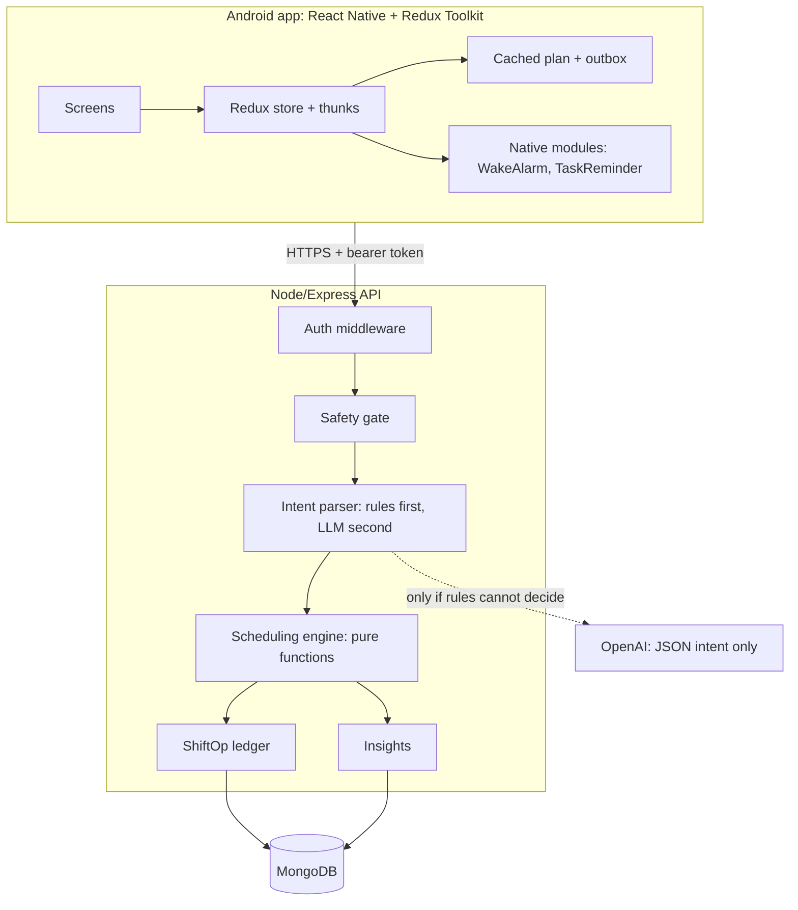
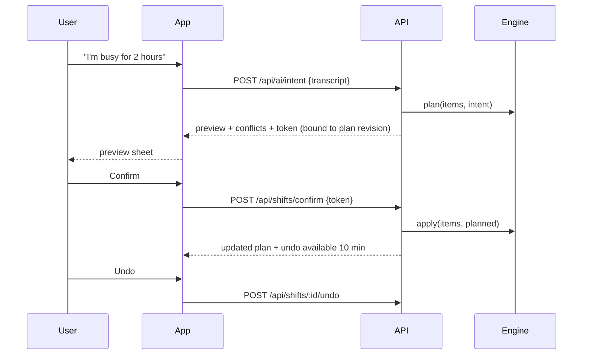
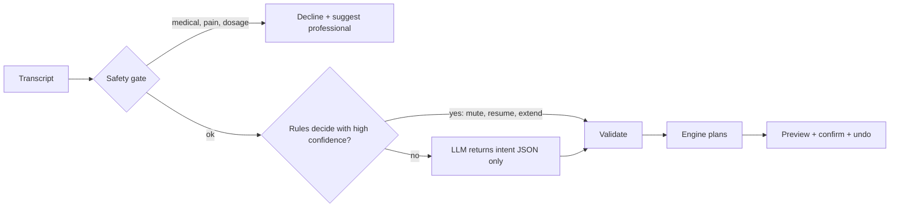

# Life OS: Phase 1 spec and architecture

Status: **draft for your approval. No code has changed.** Phase 2 (implementation) starts only after you approve this, and each milestone in section 14 stops for your go-ahead.

Companion files: [ANALYSIS.md](ANALYSIS.md) (Phase 0 findings and recommendations R1-R30), [DECISIONS.md](DECISIONS.md) (why each key choice was made, plus the approval tracker).

---

## 1. Inputs received and what is still open

Your answers so far:

| Topic | Your answer | Used as |
|---|---|---|
| Q1 merge or replace | "Merge the two in such a way that creates the best plan" | Merged routine, section 4 |
| Q2 gym logistics | 15 min each way, 1.5 h workout | Gym block = 90 min plus 15 min trips (30 min travel total) |
| Q3 sleep | 8 hours | Bedtime = next wake time minus 8 h, computed per day |
| Q15 derma stamping | "Confirmed", then: shampoo first, then stamp; 0.5 mm needle; one press per spot | Wednesday night. Card text uses exactly these values (Q-B resolved) |
| Q-A Wed-Fri gym | "Keep 60 min" | Option A: 60-min block Wed-Fri, leave for office 09:00. Mon, Tue, Sat stay 90 min |
| Q5 Saturday / WFH | Saturday is a non-office day; Mon and Tue are WFH | `dayTypes`: Mon, Tue = wfh; Wed, Thu, Fri = office; Sat = off; Sun = off |
| Q-C office exit | "Leave office around 6, go to dinner directly" | Office days: leave office 18:00, dinner out (not at home). Home by 20:30 |
| Q18 language | Stay with JavaScript | JSDoc types, `checkJs`, and runtime validation (section 13) |
| Q19 UI | "Make according to you" | New screens follow the existing theme tokens (`theme.js`) |
| Q21 login | Static login, stored in the DB, connected to backend and frontend | Section 11 |

**Still open.** Section 15 lists them. The ones that change the design are:

- **Q-A, Q-B, Q5 and the office exit time are now answered** (rows above). You also confirmed you are home by 20:30 on office days (Q-C2).
- **Safety items with no answer yet (Q13, Q14):** coaching and joint pain. The logger will ask these in-app instead of me guessing.

---

## 2. Platform constraints (verified 2026-10-19)

Checked against the official docs before designing, not assumed. Sources are linked.

| Constraint | Verified fact | Design consequence |
|---|---|---|
| Android exact alarms | On Android 14+, `SCHEDULE_EXACT_ALARM` is **denied by default** for new installs targeting API 33+. It is required for `setExact()`, `setExactAndAllowWhileIdle()` and **`setAlarmClock()`**, or a `SecurityException` is thrown. Check `canScheduleExactAlarms()` first and send the user to Settings if it is denied. [Android: exact alarms denied by default](https://developer.android.com/about/versions/14/changes/schedule-exact-alarms) | The app must check the permission at startup and show a clear fix-it banner. The current code already has `canScheduleExactAlarms` and `openExactAlarmSettings`. Keep them and add a degraded mode (inexact reminder plus a warning) instead of failing silently. |
| `USE_EXACT_ALARM` | Granted automatically and not revocable, but Google Play only allows it for **alarm clock or calendar apps**. [Android: schedule alarms](https://developer.android.com/develop/background-work/services/alarms) | The manifest declares both permissions. For your sideloaded APK that is fine. If you ever publish to Play, the wake alarm may qualify, but task reminders should not rely on it. |
| Full-screen intent | From Android 14, `USE_FULL_SCREEN_INTENT` is a special access permission. Only apps whose core function is **calling or alarms** get it automatically. Others must ask the user and **degrade gracefully** if denied. [Play Console help](https://support.google.com/googleplay/android-developer/answer/16965181?hl=en) | Keep the `canUseFullScreenIntent` check. If denied, fall back to a heads-up notification with actions. |
| Foreground services | Android 15 limits `dataSync` services to 6 h per 24 h. Foreground-service types must be declared. [Android 15 changes](https://developer.android.com/about/versions/15/behavior-changes-15) | The alarm service uses `mediaPlayback`, which is not subject to that limit. **Never** add a foreground service just to schedule reminders. |
| Expo notifications | Exact delivery needs the exact-alarm permission. Expo exposes `getExactAlarmPermissionsAsync` and `requestExactAlarmPermissionsAsync`. [Expo docs](https://docs.expo.dev/versions/latest/sdk/notifications/) | The Expo notification path is only a visual backup. The native module is the primary path on Android. |
| iOS local notifications | The system keeps only the **soonest 64** pending local notifications and discards the rest. [Apple docs](https://apple-docs.everest.mt/docs/uikit/uilocalnotification/) | If iOS is ever in scope, arm a rolling window (next 1-2 days, non-info items only) and top it up whenever the app opens. |
| iOS critical alerts | Need an Apple-granted entitlement and a second user prompt. They can sound through mute and Do Not Disturb. [Apple docs](https://developer.apple.com/documentation/BundleResources/Entitlements/com.apple.developer.usernotifications.critical-alerts) | A personal build cannot assume them. `notifications.js` already requests the critical level for `non_negotiable`, which only takes effect with Apple's entitlement. Without it the best you get is "time sensitive". |
| iOS 26 AlarmKit | System-level alarms that sound through Silent and Focus, with unlimited alarms and a full-screen UI. [MacRumors](https://www.macrumors.com/2025/06/11/ios-26-third-party-alarm-apps/) | This is the right wake-alarm primitive on iOS. Expo SDK 52 has no binding for it, so it needs a custom native module. Treat it as future work (Q20). |

**Not verified, so not relied on.** Whether `setExactAndAllowWhileIdle` is rate-limited per app while the device is in Doze, and whether that is why task calls use `setAlarmClock`. I treat the current choice as intentional. Milestone M10 includes a Doze test on a real device before changing it.

**Declared but possibly unneeded.** The manifest also declares `SYSTEM_ALERT_WINDOW`, which Play restricts. M10 checks whether anything uses it and removes it if not.

---

## 3. Architecture overview

Principle: **extend, don't rebuild.** The app already separates a native alarm (QR wake) from task-call reminders, and already keeps the LLM out of schedule changes. This spec tightens those boundaries and fills the gaps from ANALYSIS.md section 3.



Rules the architecture enforces:

1. **The LLM never writes to the schedule.** It returns a JSON intent that is validated, then the engine computes a plan, then you confirm, then the engine applies it.
2. **The engine is pure.** No database, no clock, no randomness. Everything it needs (items, rules, `now`, timezone) is passed in, so it can be tested exhaustively.
3. **Safety checks are code, not prompts.** Medical-question refusal, the sleep cutoff and the pain prompt do not depend on the model behaving.
4. **Every mutation leaves a ledger entry**, so undo and insights come from the same source.

Proposed layout (new files only; nothing existing is moved in M1-M2):

```
apps/api/src/
  engine/        time.js  shift.js  dependencies.js  conflicts.js  progression.js  (pure, tested)
  ai/            safetyGate.js  intentSchema.js  parse.js          (wraps today's voiceAssistant.js)
  auth/          password.js  sessions.js  middleware.js  routes.js
  models/        (existing models.js split gradually; new models added here)
  routes/        auth.js  shifts.js  workouts.js  export.js        (new routers; routes.js stays)
apps/mobile/src/
  screens/       LoginScreen  ShiftPreviewSheet  WorkoutLogScreen  ExerciseCard  CheckInSheet
  offline/       outbox.js  planCache.js  horizon.js
```

---

## 4. The merged routine (the "best plan")

### 4.1 What I merged, and the rules I used

- **plan.md wins on content.** Gym split, meals, supplements, skincare rotation and hair rotation.
- **The existing app wins on structure and protection.** QR wake alarm, study blocks, sleep protection, tomorrow-prep call, the four priorities (Skin, Hair, Workout, Study) and everything the AI can already do.
- **Where they directly conflict, plan.md wins**, and I list it below: no jojoba on the face, no T-bar, stamping on Wednesday not Saturday.
- **Nothing is silently dropped.** Retired items are listed in 4.4.
- **Times are derived, not hard-coded.** Each item hangs off an anchor (wake, workout start, home time, bedtime), the way the engine already works, so changing one setting moves the right items.

### 4.2 Time budget (your numbers) and the one real conflict

Your numbers: 15 min trip each way, 90 min workout, 8 h sleep.

- **Wake time.** plan.md says 06:45, but it also puts the banana at 06:45 and the gym at 07:00, which cannot work with a 15-minute trip. I keep your current **06:00** wake. That leaves wake, amla, dressing and banana before a 06:45 departure, and gym at 07:00.
- **Bedtime.** 8 h before the next wake time (table below).
- **Q-A: Wed-Fri do not fit 90 minutes. Decided: option A (60 min).** Gym 07:00-08:30, home 08:45, plus the 55 minutes plan.md itself allows for breakfast, supplements and skincare, means you leave for the office at about **09:40**, not 09:00. Options:

| Option | Gym block on Wed-Fri | Leave for office | Trade-off |
|---|---|---|---|
| **A (chosen)** | 60 min (plan.md's 50-min sessions plus warm-up and cooldown) | 09:00, as in plan.md | Mon, Tue and Sat keep the full 90 min |
| B | 90 min | about 09:40 | Only works if your office hours allow it |
| C | 90 min, wake 05:15 | 09:00 | With 8 h sleep this means bed at 21:15. Not recommended. |

The tables below assume **A**. Switching is a one-value change (`gymBlockMin` per day type), not a rewrite.

### 4.3 Proposed weekly schedule (all times IST)

Bedtime = next morning's wake time minus 8 h. Safety-related content follows the decisions in section 9.5.

| Time | Mon (WFH) | Tue (WFH) | Wed (office) | Thu (office) | Fri (office) | Sat | Sun |
|---|---|---|---|---|---|---|---|
| Wake (QR alarm) | 06:00 | 06:00 | 06:00 | 06:00 | 06:00 | 06:45 | 07:30 |
| Amla | 06:05 | - | 06:05 | - | 06:05 | - | - |
| Banana, then leave | 06:45 | 06:45 | 06:45 | 06:45 | 06:45 | 07:15 | - |
| Workout | 07:00-08:30 Push | 07:00-08:30 Pull | 07:00-08:00 Legs | 07:00-08:00 Upper circuit | 07:00-08:00 Core and intervals | 07:30-09:00 Full body | 09:00 walk or mobility, 30 min |
| Back home | 08:45 | 08:45 | 08:15 | 08:15 | 08:15 | 09:15 | - |
| Breakfast, creatine, omega-3 | 08:50 | 08:50 | 08:20 | 08:20 | 08:20 | 09:20 | 08:30 breakfast; supplements only if you confirm (Q7) |
| AM skin | 09:20 | 09:20 | 08:45 | 08:45 | 08:45 | 09:50 (sunscreen, new) | - |
| Leave for office | - | - | 09:00 | 09:00 | 09:00 | - | - |
| Leave office, go straight to dinner | - | - | 18:00 | 18:00 | 18:00 | - | - |
| Lunch + seed blend | 13:00 | 13:00 | 13:00 | 13:00 | 13:00 | 13:00 | 13:00 |
| Snack: fruit + pumpkin seeds | 16:00 | 16:00 | 16:00 | 16:00 | 16:00 | 16:00 | 16:00 |
| Tomorrow-prep call | 19:15 | 19:15 | 20:40 | 20:40 | 20:40 | 19:15 | 19:15 |
| Dinner (new) | 19:30 | 19:30 | out, about 18:30 (reminder at 18:00, you set the time) | out, about 18:30 | out, about 18:30 | 20:00 | 20:00 |
| Home (office days) | - | - | **20:30** (you confirmed) | 20:30 | 20:30 | - | - |
| PM skin + hair | 20:00 | 20:00 | 21:00 (shampoo + stamp, about 40 min) | 21:00 | 21:00 | 20:30 | 20:30 |
| Study (flexible) | 21:00 | 21:00 | optional 20 min if time allows | optional 20 min at 21:30 | 21:30-22:15 | - | 10:30 |
| Wind-down, screens down | 21:30 | 21:30 | 21:45 | 21:50 | 22:15 | 23:00 | 21:30 |
| **Bed (8 h before next wake)** | **22:00** | **22:00** | **22:00** | **22:00** | **22:45** | **23:30** | **22:00** |

Night routine contents (from plan.md):

| Night | Skin | Hair |
|---|---|---|
| Mon | Cleanser, bare (no products) | Red light 5-7 min, rosemary oil, leave on overnight |
| Tue | Cleanser, 2% salicylic acid, moisturizer | Mito-Active serum on roots |
| Wed | Cleanser, bare | Shampoo and towel-dry, then **derma stamping**: 0.5 mm needle, one press per spot. No oils, serums or sprays tonight |
| Thu | Cleanser, snail mucin, moisturizer | Red light. Rosemary oil is paused until a dermatologist confirms the gap after stamping (section 9.5) |
| Fri | Cleanser, bare | Wash out oil with SBL Arnica shampoo, Mito-Active serum on clean roots |
| Sat | Cleanser, 2% salicylic acid, moisturizer | Fenugreek spray, leave in |
| Sun | Cleanser, snail mucin, moisturizer | Wash, towel-dry, Mito-Active serum |
| Every night | Silk or satin pillowcase (nightly checklist step) | |

Other notes:

- **Hydration nudges** at 11:00 and 15:00 are info-level reminders, not targets (R15).
- **Sunscreen reapply** at 13:30 on office days is optional and info-level (R17).
- **Saturday's Cult.fit class** is a placeholder until you tell me the time (Q4). It is optional, with a pre-class snack reminder 90 minutes earlier and a soreness check-in (see R1 in section 9.5).
- **Study is flexible on purpose.** On Wed-Fri the stamping night pushes study to the end of the evening. When time is short, the engine compresses or skips study first and never cuts sleep.
- The tomorrow-prep call moves off 20:00 so it never lands on the skincare slot.

### 4.4 Kept, changed, retired

| Item | Result |
|---|---|
| QR wake alarm | **Kept** (moved to the new wake times) |
| Study blocks (DSA, system design, Angular) | **Kept**, flexible |
| Sleep protection | **Kept**, now computed as wake minus 8 h |
| Tomorrow-prep call | **Kept**, moved earlier |
| Carry-forward AI tasks, focus pause, skip, shift, defer | **Kept** |
| Workouts (run and bodyweight program) | **Replaced** by the gym split |
| Amla (daily, optional) | **Changed** to Mon, Wed, Fri |
| Breakfast ("protein breakfast + fruit") | **Replaced** by muesli, eggs, creatine, omega-3 |
| Seeds and dry-fruit rotation | **Retired**. plan.md specifies the foods now. |
| Seasonal fruit at 14:00 | **Moved** to the 16:00 snack, keeping the seasonal list as suggestions |
| Face jojoba and T-bar | **Retired** (direct conflict, R20) |
| Saturday stamp protocol, Wednesday oil-and-knead | **Replaced** by plan.md's rotation |
| Commute / office / home / easy-walk items | **Changed** to fit the table. The easy evening walk is retired because the evening has no room. It can be re-added. |

---

## 5. Data model

All additions are backward-compatible. Existing documents keep working, and past `DailyPlan` records are never rewritten, so Insights history stays valid.

### 5.1 Plan items (extends `PlanItemSchema`)

| Field | New? | Purpose |
|---|---|---|
| `category` | new | `workout`, `meal`, `supplement`, `skincare`, `haircare`, `study`, `sleep`, `work`, `wellness`. `domain` stays for colors and scoring. |
| `plannedAt` | new | Original template time. **Never changes**, so insights can compare planned vs shifted vs actual. |
| `scheduledAt` | existing | Current time (changes when shifted). |
| `movable` | new | `fixed` (never moved), `soft` (moved with limits), `free`. Replaces overloading `anchor: "fixed"`. |
| `minDurationMin` | new | Lowest duration the engine may compress to, otherwise it cannot be compressed. |
| `deps[]` | new | `{type: before | with | after | blocks, target, minGapMin?, window?}` (section 6.3) |
| `learn` | new | `{why, cues[], mistakes[], safetyNote}` for "Why this?" cards, curated static text |
| `exerciseKeys[]` | new | Links a workout item to the exercise catalog |
| `blockId` | new | `morning`, `afternoon`, `night`, for the day-block view |
| `revision` | on `DailyPlan` | Incremented on every change. Confirmation tokens bind to it. |

### 5.2 New collections

| Collection | Key fields | Notes |
|---|---|---|
| `AuthAccount` | `userId`, `username` (unique), `passwordHash` (scrypt, per-user salt), `createdAt` | One static account, no sign-up route |
| `Session` | `userId`, `tokenHash` (SHA-256), `deviceLabel`, `createdAt`, `lastUsedAt`, `expiresAt` | TTL index. Revoked on delete-all or password change. |
| `ShiftOp` | `userId`, `date`, `source` (`ai`, `manual`), `intent`, `status` (`previewed`, `applied`, `undone`, `expired`), `planRevision`, `before[]`, `after[]`, `conflicts[]`, `reason`, timestamps | The undo and insights source for every schedule change |
| `Exercise` | `key`, `name`, `muscleGroup`, `equipment`, `cues[]`, `mistakes[]`, `why`, `isTechnical`, `substitutes[]`, `safetyNote` | Seeded, curated, not LLM-generated |
| `WorkoutSession` | `userId`, `date`, `planItemId`, `startedAt`, `endedAt`, `checkin {painFlag, soreness0to4, sleepOk}`, `sets[]`, `notes` | `sets[]` embeds `{exerciseKey, setIndex, reps, weightKg, rpe, isWarmup, painFlag}` |
| `Suggestion` | `userId`, `type` (`progress`, `hold`, `reduce`, `deload`, `extra_rest`), `exerciseKey?`, `reasonCodes[]`, `status` (`shown`, `accepted`, `dismissed`), timestamps | Records what the app suggested and what you did |
| `WeeklyRollup` | `userId`, `weekKey`, computed counters | Cache only, rebuildable from events |

### 5.3 User additions

`sleepHours` (8), `sleepMode` (`auto` = wake minus hours), `gymBlockMin` per day type, `dayTypes` per weekday (a map, so Q5 is a one-value answer), `aiEnabled`, `deloadEveryWeeks` (5). The existing `sleepTarget` stays as a manual override.

### 5.4 Event log (insights foundation)

`LifeEvent` already exists. Keep one registry of event types in code (`events.js`) so insights never depends on stray strings. Add `itemId`, `category`, `plannedAt`, `actualAt`, `shiftOpId` and `schemaVersion`. Event types: `item_completed`, `item_skipped`, `shift_applied`, `shift_undone`, `pause_started`, `pause_ended`, `session_started`, `session_ended`, `checkin`, `suggestion_shown`, `suggestion_accepted`, `suggestion_dismissed`, `ai_declined` (category only, not the text).

### 5.5 Migration

- New template version `raj-v2`. Old plans keep `generatedFrom: raj-v1`.
- **Danger found:** `render.yaml` and `.env.example` mention `SEED_ON_START=true`, and the seed overwrites templates on every boot. Before v2 ships, the seed must only write a template when its version is missing, never overwrite a newer one.
- The v2 seed is written to the DB as a **draft** (`approved: false`) and activated only after you review the generated week.

---

## 6. Scheduling engine

### 6.1 Contract

```js
/**
 * Pure. No DB, no Date.now(), no randomness.
 * @param {PlanItem[]} items  today's items
 * @param {Intent} intent     validated intent (shift, skip, reschedule, pause)
 * @param {{now: number, tz: string, bedAt: number, windDownMin: number}} ctx
 * @returns {{ok: boolean, changes: Change[], conflicts: Conflict[], dropped: Item[], preview: Preview}}
 */
plan(items, intent, ctx)
```

`apply(items, planned)` is a second pure function that returns the new item list. The route layer only does I/O, wrapping both calls.

### 6.2 Time handling

- The engine works on **absolute instants plus an IANA timezone**, converting `HH:MM` at the edges (`toInstant(date, hhmm, tz)`, `fromInstant`). A plan is one local calendar day.
- Today the code hard-codes `Asia/Kolkata` in many places (`todayIST`, `hhmmIST`, the mobile `startMillis`). M2 moves these into one `time.js` that takes the user's `timezone`. India has no daylight saving, so nothing breaks today. The tests prove the engine is correct anyway.

### 6.3 Rules, in priority order

1. **Finished or in-progress items are untouched** (`done`, `skipped`, or `startedAt` set).
2. **`fixed` items never move.** If the requested shift would make a movable item cross a fixed one, that is a conflict.
3. **Dependencies move as a group.** `before` (banana 15 min before workout), `with` (supplements with breakfast), `after`, `blocks` (stamping blocks oils tonight). A move that breaks a `blocks` rule is refused, not warned.
4. **Sleep cutoff is protected.** Nothing may end after `bedAt - windDownMin`. Options offered in the preview, in order: compress items that allow it, skip `soft` or `free` items (study first), and refuse. `non_negotiable` items are never silently dropped.
5. **No midnight wrap.** A time past 23:59 is a conflict ("this would push Dinner to tomorrow"), never `00:30` on the same day. This replaces today's modulo-24 behavior.
6. **Overlaps cascade minimally.** Later items are pushed only as far as needed, keeping at least the 5-minute call gap, and order is preserved.
7. **Conflicts have severity.** `block` (cannot apply) and `warn` (can apply, shown in the preview), for example "workout now starts at 21:10" or "dinner overlaps stamping".
8. **The original time is never lost.** `plannedAt` stays, `scheduledAt` changes, and the `ShiftOp` stores before and after.

### 6.4 Preview, confirm, undo



- A token is valid only while the plan revision is unchanged. If something else changed the plan meanwhile, you get "plan changed, preview again", never a stale apply.
- **Undo** restores the stored `before` state when the affected items are still untouched. If you completed or edited one in between, undo restores the rest and tells you which was left alone.
- **Pause ("mute alarms") stays immediate**, with no confirm step. It is cheap, reversible ("I'm back"), and the whole point is to be quiet right now. Skip, shift and reschedule get the preview.

### 6.5 Test matrix (written first, in M2)

| Case | Expectation |
|---|---|
| Shift crosses midnight (22:30 + 2 h) | Conflict, never `00:30` today |
| Shift pushes dinner into the bedtime window | Cutoff conflict, with compress/skip options |
| Fixed item inside the shifted range | Fixed item stays, conflict reported |
| `before` dependency (banana, workout) | Both move together, gap preserved |
| `blocks` dependency (stamping, oils) | Move refused if it would break the rule |
| Overlap after shift | Minimal cascade, gap at least 5 min, order preserved |
| Done or skipped item in range | Untouched |
| Item already started | Untouched |
| Negative shift (earlier) before `now` | Cannot move into the past |
| Shift of 0 or over 12 h | Rejected |
| Selected-tasks scope | Only those, plus their dependency group |
| Compress below `minDurationMin` | Not allowed, so conflict |
| DST spring-forward and fall-back day (America/New_York) | Correct instants, no skipped or duplicated hour |
| Asia/Kolkata (no DST) | Same results as the current behavior |
| Undo after partial changes | Restores untouched items, reports the rest |
| Stale token | Rejected |
| Idempotent confirm (double tap) | Applied once |

---

## 7. Alarm and reminder strategy

Two systems, two UX contracts. They share the OS primitive today (`setAlarmClock`), which is fine.

| | Alarm (wake) | Reminder / task call |
|---|---|---|
| Purpose | Critical wake-up | Task nudges |
| Dismiss | Hold the wake QR code in the camera for 15 s | Ready, snooze, remind later, done, skip |
| Silent and DND | Rings through | Level-dependent (`non_negotiable` asks to bypass DND) |
| Survives app kill and reboot | Yes (boot receiver, native store) | Yes (same) |
| Today's mute | Not affected by the AI sheet mute. A long focus pause that spans the wake time does cancel it (existing behavior in `AppBackgroundSync.js`, to be reviewed in M10). | Muted by the AI sheet lease and by focus pauses |

Work to do (Phase 2):

1. **Rolling horizon.** Today only the current day's reminders are armed. If the app is not opened tonight, tomorrow's task calls never exist (only the repeating wake alarm does). M8 adds `/api/horizon?days=3` and arms the next 3 days natively, so reminders survive the app being killed. On iOS the cap is 64, so only non-info items for 1-2 days.
2. **Permission fix-it flow:** exact alarm, full-screen intent, notifications, battery optimization. One screen shows each as green or red with a button. Degraded modes are explicit (section 2).
3. **Device checklist (M10):** permission denied paths, Doze, reboot, app killed, QR dismiss, AI sheet mute lease expiring.

---

## 8. AI integration

### 8.1 Pipeline



### 8.2 Safety gate (R27)

Runs **before** any model call, in code. It matches pain, injury, symptoms, diagnosis, dosage, "is it safe to", skin or scalp reactions, and similar. Result: a short, fixed reply ("I can't advise on that. For pain, injuries, supplements or skin reactions, please check with a doctor or dermatologist."), **no schedule change**, and an `ai_declined` event that records the category only. Test list in M5 includes obvious and sneaky phrasings, and "mute alarms, my knee hurts" (gate fires first, nothing is muted).

### 8.3 Intent schema v2 (strict JSON, validated at runtime)

Intents: `shift`, `skip`, `reschedule`, `pause`, `resume`, `extend`, `defer`, `add_task`, `unknown`. Fields: `scope` (`all`, `selected`, `named`, `window`), `offsetMin`, `durationMin`, `until`, `targetIds`, `reason`. Rules: ids are checked against today's plan, shift is limited to 12 h, unknown fields are rejected, and `unknown` is the default when unsure. This extends today's `voiceAssistant.js` schema. It does not replace it.

### 8.4 Other design points

- **Rules first.** Mute, resume and extend are decided by the deterministic parser alone (already true after today's fix), so they are instant and work when OpenAI is slow or down. This list grows only for phrases that are unambiguous.
- **The transcript is untrusted input.** Output is schema-constrained, ids are validated, and nothing the model writes is shown as advice or executed as text. Free-text fields (reason) are length-limited and stored as data.
- **Learn mode is not generated by the LLM.** "Why this?" cards and form cues are curated text in the DB. For a health-adjacent app, wrong confident text from a model is a risk with no upside.
- **Privacy.** Transcripts leave the phone for OpenAI. Settings gets an `aiEnabled` switch. When off, only the deterministic parser runs, and unrecognized requests get a clear message.
- **Cost and abuse.** Per-session rate limit on the AI endpoint, and a 10-second client timeout with a clear error (the client side of that timeout is already done).

---

## 9. Workout logger, Learn mode, safety

### 9.1 Logger

Per exercise: sets, reps, weight, RPE 1-10, warm-up flag, pain flag. Each exercise shows **last time** (date, best working set, RPE) as a reference. Rest-timer suggestion per R9. All data is entered by you. The app never auto-fills effort.

### 9.2 Progression suggestions (pure function, R7)

The app **suggests**, you decide. Rules, in order:

1. **Pain flag in the last session:** suggest hold, never increase, and show the "see a professional if it persists" line.
2. **No history:** no number. "Start light enough to finish every set with 2-4 reps left."
3. **Gap of 14 days or more:** suggest about 10% less, rounded to the equipment step.
4. **Last session RPE 9 or higher, or 2+ missed sessions in 14 days:** suggest hold.
5. **Every set hit the top of the rep range at RPE 8 or below:** suggest the **smallest step** (about 1-2 kg per dumbbell, 2.5 kg barbell or plate, 2.5-5 kg machine or cable).
6. Otherwise: hold and aim for more reps.

Never more than one step per session.

### 9.3 Fatigue, extra rest day and deload (R11)

- **Signals:** RPE 9-10 on at least 60% of sets for two sessions in a row, or soreness 3/4 or higher twice in 7 days, or any pain flag.
- **Response:** a `Suggestion` of `extra_rest` (turn the next training day into a rest or mobility day through a normal preview-and-confirm shift) or `deload`.
- **Scheduled deload:** after `deloadEveryWeeks` (5) training weeks, suggest a deload week: same exercises, about half the sets, lighter, RPE 6 or less. You can accept, delay or dismiss. The choice is logged.

### 9.4 Check-in and pain prompt (R10)

A 30-second sheet before each workout: pain today (yes or no), soreness 0-4, slept OK. A "yes" to pain shows: *"Sharp or joint pain means stop that movement. Dull muscle effort is normal. If pain persists, please see a professional."* Every exercise card carries the same line. The app never diagnoses.

### 9.5 Safety content: how each item was decided

You told me to skip anything I judge risky, and to choose the rest. My rule: **adopt anything that only adds a guard or lowers risk. Never add a new risk. Where plan.md's own content is the risk, show a safer option on the card and let you choose it. Never silently swap an exercise.**

| Item | Decision | How it appears |
|---|---|---|
| R1 Saturday double session | **Adopt, as optional** | The Cult.fit class is optional and marked "low intensity or skip". The full-body session stays as written. |
| R2 bench dips | **Adopt as an option** | Dips stay as written, with a "swap for cable pushdown or close-grip push-up" button on the card. |
| R3 clean and press | **Adopt** | Card says "light technique practice for the first 4 weeks". No new exercise added. |
| R4 deadlift | **Adopt** | Form-cue card, "start light", and a one-time "ask a gym trainer to check your form" note. |
| R5 pull-ups | **Adopt** | "Assisted version and stop about 2 reps before failure" note. |
| R6 RPE 6-8 | **Adopt** | Logger records RPE and warns above 8. |
| R7 progression | **Adopt** | Suggestions only, smallest step, hold when RPE is 9 or more or sessions were missed. |
| R8 warm-up and cooldown | **Adopt** | Added as checklist steps, not as extra training volume. |
| R9 rest times | **Adopt** | Shown as guidance on the cards. |
| R10 pain prompt | **Adopt** | Check-in sheet and the line on every exercise card (9.4). |
| R11 deload and extra rest | **Adopt, suggestion only** | Always a suggestion you can dismiss. |
| R14 Sunday supplements | **Do not adopt** | Sunday has no creatine or omega-3. Dose and timing are a professional's call. |
| R18 stamping hygiene | **Adopt** | Shampoo first, no oils on the stamping night (enforced as a `blocks` dependency). |
| R19 dilution | **Do not adopt** | The card shows only your numbers: 0.5 mm, one press per spot. No dilution values, because you did not give any and I will not invent them. |
| R27 AI declines medical questions | **Adopt** | Code-level gate before the LLM. |

Two plan.md items I am **holding back** until you confirm them (Q16, Q17), because they are the highest-risk parts of the content:
- **Thursday rosemary oil** falls about 24 h after stamping. It stays in the seed as an optional step marked "paused: confirm the gap with a dermatologist". Red light on Thursday stays.
- **Oil left on from Monday night to Friday's wash** is kept as written, with a note that you can wash earlier. I am not changing your hair routine without your say.

The logger and schema support every item, so you can switch any of them on later.

### 9.6 Hard product rules (R29)

No calorie, macro or body-weight fields anywhere. Meals and supplements track "did you do it", not contents. Supplement cards say **confirm dose and timing with a professional**.

---

## 10. Insights

Builds on the existing `insights.js`, which already computes adherence by domain, streaks, average lateness, on-time rate, skip reasons and a cached AI narration.

| Metric | Source | Status |
|---|---|---|
| Adherence by category (workout, meal, supplement, skincare, haircare) | `category` on items plus events | New (domain version exists) |
| Streaks per category | events | Overall exists; per category new |
| Timing consistency | `actualAt` vs `plannedAt` (and vs shifted `scheduledAt`) | Lateness exists; spread (variability) and planned-vs-shifted are new |
| Day-shift frequency | `ShiftOp` ledger: count per week, minutes shifted, most-shifted items, reasons | New |
| Workout progress | sessions per week, volume load per exercise, best working set, RPE trend | New |
| Recovery signals | check-ins, soreness, pain flags, suggestions accepted or dismissed | New |

The AI narration stays "numbers computed by code, wording by the model", and the safety gate applies to anything health-related it says. No medical conclusions.

---

## 11. Authentication and privacy

### 11.1 Static login stored in the DB

- **One account, no sign-up.** `AuthAccount` holds the username and a **scrypt** hash with a per-user salt. It is created at first boot from `LIFEOS_LOGIN_USER` and `LIFEOS_LOGIN_PASSWORD`, then those env vars are no longer needed. Change it later with `npm run auth:set`.
- `POST /api/auth/login` returns an **opaque random token** (32 bytes). Only its SHA-256 hash is stored in `Session`. Sliding 90-day expiry. Opaque tokens, not JWT, so logout, delete-all and password change can revoke instantly.
- **Middleware on every `/api/*`** route except `/api/auth/login` and `/health`. `getUser()` then reads the user from the session instead of looking up the name "Raj".
- **Login rate limiting:** 5 failures per minute per IP, then back-off. Constant-time comparison. Generic error text.
- **Mobile:** a Login screen, token kept in `expo-secure-store` (Android Keystore), `api.js` adds the `Authorization` header, a 401 clears the token and returns to Login. Native code never calls the API, so only JavaScript needs the token.
- **Web dashboard:** the page at `/` stays public, but its API calls need the token, so it gets a login form.
- **CORS:** restricted to the web app's own origin. The mobile app does not use CORS.

### 11.2 Privacy requirements

| Requirement | Plan |
|---|---|
| Encrypted in transit | Render serves HTTPS. In M9, release builds are made to accept only an `https://` server URL (today the server-URL setting would also accept plain `http://`). |
| Encrypted at rest | **Not verified, so not claimed.** `render.yaml` only says to set `MONGODB_URI` (Atlas). I have not checked your cluster tier's encryption-at-rest setting, so M9 includes confirming it in the Atlas console. |
| Atlas network access | The deploy notes say allow `0.0.0.0/0`. With auth added that is acceptable, but do not run without it. |
| No sharing or selling | No analytics SDKs. The only third party is OpenAI, for intent parsing (switchable off). |
| Export | `GET /api/export`: your data as one JSON file. |
| Delete-all | `DELETE /api/data` needs your password plus the typed phrase `DELETE MY DATA`, removes every collection for the user and revokes all sessions. |
| Local-first | Cached plan and outbox on the phone (section 12). |
| Logs | Never log transcripts, tokens or passwords. |

### 11.3 Deployment warning

Adding auth will lock out any **already installed APK** (it has no login). Do not deploy M1 to Render before tomorrow's demo (section 14).

---

## 12. Offline and background behavior

- **Cached plan.** Today's and the next days' plans are cached on the phone. The app opens instantly offline and shows a small "offline" marker.
- **Outbox.** Complete, skip, step toggles and workout sets are queued with client-generated ids and replayed in order when the network returns. The server treats a repeated id as already applied, so a lost reply never creates duplicates (the same reason a timed-out POST is not auto-retried today).
- **Conflict policy.** Last write wins per item field, using client timestamps, with the server ledger as the record. AI features need the network and say so plainly.
- **App killed or phone rebooted.** Native alarms and the horizon survive both. The boot receiver exists and M10 verifies it on a device.
- **Server cold start.** Render's free tier can take around a minute to wake, so the 45-second request timeout, the retry for reads, and a visible "waking up" message matter for demos.

---

## 13. Engineering standards

- **JavaScript with types where it counts.** JSDoc typedefs, a `jsconfig.json` with `checkJs`, and `tsc --noEmit` as a check step (dev-only dependency). No migration, no build step.
- **Runtime validation with `zod`** for every request body, the intent schema and event payloads. This is also the safety net for LLM output.
- **State:** Redux Toolkit slices and thunks on mobile, as you require.
- **Tests (`node:test`):** the engine matrix (6.5), the safety gate, intent parsing, the progression and fatigue rules, auth (hashing, session expiry, rate limit, middleware), the export and delete-all flow, and the mobile planner (`taskCallPlanner.js`, which has no tests today).
- **CI check:** `npm test` plus `tsc --noEmit` must pass before each milestone is reported done.

---

## 14. Milestones (Phase 2)

Each milestone is small, runnable, tested, summarized, and then **I wait for your go-ahead.** All work happens on a branch. The current build, tagged, remains the demo build.

| # | Milestone | Done when |
|---|---|---|
| M0 | Demo freeze: tag the current commit, create the working branch, confirm the existing tests pass | Tag and branch exist, tests green |
| M1 | **Auth:** models, login, middleware, seed from env, rate limit, mobile Login screen and secure token store, web login, tests | Unauthenticated calls get 401, app and web log in |
| M2 | **Time and engine core:** `time.js` and the pure engine with the full test matrix (6.5) | All matrix cases pass, including DST |
| M3 | **Routine v2:** categories, dependencies, per-day wake and bedtime, the merged seed as a draft, safe seed behavior | You review the generated week and approve |
| M4 | **Shift preview, confirm, undo:** ledger, endpoints, mobile preview sheet and undo toast | Shift, skip and reschedule go through preview |
| M5 | **Safety and AI v2:** safety gate, intent schema v2, `aiEnabled` switch, pain prompt wiring | Gate tests pass, medical phrasing declines |
| M6 | **Workout logger and Learn mode:** catalog, check-in, logger, last-time, suggestions, fatigue and deload | A full session can be logged and a suggestion appears |
| M7 | **Insights v2** | New metrics visible and tested |
| M8 | **Offline and horizon:** cached plan, outbox, 3-day native arming | Airplane-mode and killed-app scenarios pass |
| M9 | **Privacy:** export, delete-all, CORS lock, encryption-at-rest verification, `.env.example` | Export and delete-all verified |
| M10 | **Hardening:** device checklist (section 7), permission screen, remove unused permissions, performance | Checklist signed off |

Order rationale: auth first because health data must not be open; the engine second because everything else (shifts, safety, AI) depends on it.

---

## 15. Questions I still need answered

**Blocking the design**

- **Q-A, Q-B, Q5, Q-C: answered** (section 1). Wed-Fri gym is 60 min; stamping is shampoo first, 0.5 mm, one press per spot; Saturday is off and Mon-Tue are WFH; you leave the office around 18:00 and go to dinner.
- **Q-C2: answered.** You are home by 20:30 on office days, so PM skin and hair start at 21:00. Dinner time is yours to set in the app (default reminder 18:00, dinner about 18:30). Study is the flexible item: only 20 optional minutes on Wed and Thu, 45 on Fri.

**Needed before the related content ships**

- **Q4.** Saturday Cult.fit class time and format.
- **Q6.** What you eat for dinner, so the reminder text is yours.
- **Q7.** Sunday creatine and omega-3, yes or no (confirm with a professional).
- **Q8-Q10.** The "no banana" reason, amla before banana order, satin pillowcase as nightly step.
- **Q11-Q12.** Which equipment for each "or" exercise, and current working weights.
- **Q13-Q14 (safety).** Any coaching on deadlift, squat, clean and press; any joint pain or injury (yes or no is enough).
- **Q16-Q17.** Rosemary oil dilution; whether the oil really stays on from Monday night to Friday.
- **Q20.** Is iOS in scope?

**Approvals**

- DECISIONS.md has the tracker for R1-R30. Reply "approve all non-safety" or list changes. Safety items (S) need an explicit yes each.
